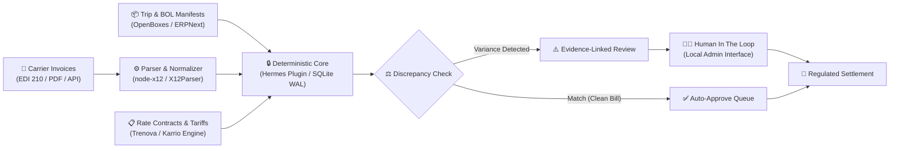

  

      

# 🚚 Awesome Automated Freight & Logistics Billing Audits 📊

> **A curated showcase of industry-leading enterprise SaaS platforms and deterministic open-source engines dedicated to freight bill auditing, carrier rate compliance, electronic data interchange (EDI) invoice validation, and payment automation.**

---

### 🔍 Quick SEO Keywords & Topics
`Freight Audit and Payment (FAP)` • `Automated Freight Billing` • `Carrier Invoice Validation` • `EDI 210 Invoice Parsing` • `EDI 204 Tender Reconciliation` • `Logistics Spend Management` • `Discrepancy Resolution` • `Rate Compliance Engine` • `Deterministic Freight Audit` • `3-Way Invoice Matching` • `Transportation Cost Recovery`

---

## 📑 Table of Contents
- [🌐 Sector Overview & Market Dynamics](#-sector-overview--market-dynamics)
- [🏢 SaaS & Hosted Enterprise Audit Platforms](#-saas--hosted-enterprise-audit-platforms)
- [💻 Open-Source GitHub Projects](#-open-source-github-projects)
- [📐 Deterministic Audit Architecture](#-deterministic-audit-architecture)
- [🤝 How to Contribute](#-how-to-contribute)
- [⚖️ Disclaimer & Financial Regulations](#-disclaimer--financial-regulations)
- [📈 Star History](#-star-history)
- [💖 Support & Sponsorship](#-support--sponsorship)

---

## 🌐 Sector Overview & Market Dynamics

The global **Freight Audit and Payment (FAP)** and automated logistics billing reconciliation sector is currently valued between **$1.2 billion and $5.5 billion** (depending on whether purely software/SaaS licensing is isolated or comprehensive outsourced BPO managed services are included), and is projected to surpass **$15 billion by 2034–2036** expanding at a compound annual growth rate (**CAGR of 11.0% to 14.2%**).

This industry is **highly fragmented** rather than concentrated or winner-take-all. This fragmentation persists because transportation networks involve thousands of regional and international carriers, disparate EDI standards (`EDI 210`, `EDI 204`, `EDI 214`, `API`, `PDF`), highly customized multimodal tariffs (parcel, LTL, FTL, ocean container demurrage, rail), and distinct buyer preferences that split between pure software/AI automation and fully outsourced, bank-regulated managed settlement services.

---

## 🏢 SaaS & Hosted Enterprise Audit Platforms

These enterprise SaaS platforms compare carrier line-item invoices against contracted baseline tariffs, bills of lading (BOL), dispatch manifests, and accessorial surcharge schedules—detecting overcharges, billing anomalies, and duplicate billings prior to releasing funds.

The table below is **sorted in descending order by Company Size (Market Capitalization, Valuation, or Annual Revenue)**:

| 🏢 Platform / Vendor | 📈 Company Size (Valuation / Revenue) | 💳 Starting Tier Pricing | 🎁 Free Tier / Trial Limits | 🔍 Core Capabilities & Audit Specialization |
| :--- | :--- | :--- | :--- | :--- |
| **[Cass Information Systems](https://www.cassinfo.com/)** | **$690M Market Cap / $203M Annual Revenue** (NASDAQ: CASS; $37B+ annual freight spend processed) | **$0.35 per invoice** (electronic EDI 210) + **$500/month** base platform fee (scales to $0.15/invoice at high enterprise volumes) | **30-day proof-of-concept audit** (evaluates up to 500 historical freight invoices with full discrepancy reporting) | Processes 35M+ invoices annually across 15,000+ carriers in 114 currencies. Integrates regulated **Cass Commercial Bank** (SOC 1 Type II, U.S. Federal Reserve regulated) for secure payment execution and global visibility via CassPort®. |
| **[enVista](https://www.envistacorp.com/)** | **$400M Valuation / ~$150M Annual Revenue** (Gartner Magic Quadrant Leader; $7B+ annual freight spend under audit) | **$1,000/month** base platform fee or **15% contingency fee** on recovered carrier overcharges | **14-day sample freight audit** (up to 250 freight invoices audited across LTL, parcel, and truckload for rate compliance) | ATOM (Advanced Transportation Optimization and Management) platform with proprietary all-modes rating engine. Audits guaranteed service compliance, accessorial fees, freight terms, and mathematical extension errors. |
| **[Loop](https://www.loop.com/)** | **$300M Valuation / ~$35M ARR** (Backed by Index Ventures & 8VC; acquired StrategIQ Commerce & Data2Logistics) | **$1,500/month** base subscription (includes up to 2,000 audited invoices/month; $0.45 per additional invoice) | **30-day sandbox pilot** (processing up to 500 invoices with proprietary Dux™ AI model and exception workflows) | AI-native Logistics Data Platform featured in 2026 Gartner® Market Guide. Proprietary **Dux™** model extracts unstructured PDF/EDI data; **Control Suite** (Policies + Control Tower) turns complex contract terms into automated approval rules. |
| **[Trax Technologies](https://www.traxtech.com/)** | **$250M Valuation / ~$65M Annual Revenue** (Backed by Strattam Capital; $24B+ freight spend across 21k+ carriers) | **$1,250/month** base platform subscription + **$0.40 per invoice** processed for multi-modal rate auditing | **30-day guided pilot** (historical freight spend benchmark on up to 1,000 invoices or 1 quarter of carrier billing data) | Global Transportation Spend Management (TSM) platform. Multi-modal support (ocean, air, ground, rail) with SKU-level ERP cost allocation, automated GL coding, and LLM pattern identification for carrier disputes. |
| **[FreightVerify](https://www.freightverify.com/)** | **$180M Valuation / ~$45M Annual Revenue** (Enterprise tier powering GM, Ford, and top industrial shippers) | **$2,000/month** baseline enterprise verification tier (includes up to 5,000 tracking milestones and rate matching) | **14-day proof-of-concept environment** (validating up to 200 real-time active or historical freight shipments) | Combines real-time supply chain milestone visibility with automated freight invoice verification. VinView product provides granular tracking of inbound freight with 90% ETA accuracy. |
| **[DDC FPO](https://www.ddcfpo.com/)** | **$120M Annual Revenue** (The DDC Group division; processes 300k shipments/day, ~33% of North American freight bills) | **$0.28 per bill of lading (BOL)** captured & audited with a **$750/month** account maintenance minimum | **14-day operational trial** (processing up to 300 test bills of lading with full Price-Per-BOL benchmarking report) | Industry-leading freight BPO. **iCapture** engine uses intelligent document extraction to classify and verify BOLs, freight bills, and carrier contracts with zero human touch; rate auditing against contracted tariffs. |
| **[ShipERP](https://www.shiperp.com/)** | **$80M Valuation / ~$20M Annual Revenue** (ERP Integrated Solutions; SAP Gold Certified Partner) | **$1,250/month** ($15,000 billed annually on SAP App Center) + standard deployment fee | **14-day guided sandbox demo** (simulated SAP VL02N freight invoice audit and carrier rating for up to 100 test shipments) | SAP-certified shipping and freight auditing solution natively integrated into SAP ECC 6.0 and S/4HANA delivery transactions (VL02N). Automates carrier rate quoting, freight bill audit, and denied party screening. |
| **[Zero Down Supply Chain](https://www.zdscs.com/)** | **$60M Valuation / ~$18M Annual Revenue** (Leading parcel, LTL, and ocean billing optimization specialist) | **$450/month** base platform subscription or **20% contingency fee** on verified carrier refunds | **30-day historical freight audit benchmark** (analyzing up to 6 months of historical shipping bills at zero upfront cost) | Proprietary **FreightOptics** software reduces erroneous shipping charges across courier, small parcel, LTL, truckload, and international ocean contracts. Automated carrier dispute and refund recovery. |
| **[Intramotev](https://www.intramotev.com/)** | **$40M Valuation / ~$5M Annual Revenue** (Backed by Idealab X; commercial deployments with ÖBB Rail Cargo Group) | **$3,500/month** per deployed TugVolt railcar lease (includes automated telematics billing, energy usage & trip tracking software) | **30-day route feasibility assessment** (modeling 1 dedicated industrial rail corridor with zero hardware commitment) | Autonomous zero-emission railcars (**TugVolt** and **ReVolt**). Provides automated digital trip manifests, real-time telemetry, and energy consumption audit logs for first-mile and last-mile rail freight. |
| **[Transmetrics](https://transmetrics.ai/)** | **$35M Valuation / ~$8M Annual Revenue** (Backed by European Innovation Council; ISO 27001 certified) | **€490/month** (~$535/mo) starter tier for SpotLoad (up to 10 vehicles) or **€1,500/month** for NetMetrics planning & audit | **30-day (1-month) free trial open beta** (full platform access analyzing up to 100 historical transport lanes/loads) | AI data-and-intelligence layer atop existing TMS/ERP systems. Products include **SpotLoad** for spot-load profitability, **FleetMetrics** for asset analytics, and **NetMetrics** for linehaul cost optimization and billing auditing. |

---

## 💻 Open-Source GitHub Projects

An expanded collection of open-source repositories for self-hosting, deterministic reconciliation engines, EDI parsers, and logistics ERP/TMS platforms.

The repositories below are **sorted in descending order by GitHub Stars_Count**:

1. **[NousResearch/hermes-agent](https://github.com/NousResearch/hermes-agent)**   
   *Payer-side freight reconciliation plugin for Hermes Agent (MIT).* Imports carrier bills and trip ledgers into a **deterministic local core** (SQLite, WAL, strictly local storage), recalculates line items against contracted rates, and produces **evidence-linked difference lists** for human review. Features **14 MCP tools** over uvx stdio. **Never auto-approves payments or writes back to ERP/TMS**—all final approvals route through an isolated local admin page. Inputs are frozen by cryptographic digest for deterministic re-runs.

2. **[n8n-io/n8n](https://github.com/n8n-io/n8n)**   
   *Fair-code workflow automation platform.* Extensively used in freight audit pipelines to automate carrier PDF invoice ingestion, webhook-based rate lookups, automated tolerance checks, and exception alerts dispatched directly to Slack, Microsoft Teams, or accounting queues.

3. **[odoo/odoo](https://github.com/odoo/odoo)**   
   *Open-source ERP suite (LGPL-3.0).* Features robust Purchase, Inventory, and Accounting modules capable of performing 3-way freight invoice matching (Purchase Order vs. Delivery Order / BOL vs. Carrier Bill) and automated landed cost allocation across inventory items.

4. **[frappe/erpnext](https://github.com/frappe/erpnext)**   
   *Open-source ERP system (GPL-3.0).* Provides complete Purchase Order and Accounts Payable clearing workflows, Landed Cost Vouchers, shipment tracking reconciliation, and custom scriptable validation triggers for freight rate verification.

5. **[openboxes/openboxes](https://github.com/openboxes/openboxes)**   
   *Open-source supply chain and inventory management platform (EPL-1.0).* Built for complex logistics and humanitarian supply chains; provides structured shipment manifest tracking, purchase order reconciliation, and bill-of-lading auditing.

6. **[karrioapi/karrio](https://github.com/karrioapi/karrio)**   
   *Open-source multi-carrier shipping API & platform (Apache-2.0).* Integrates with 30+ carrier APIs (FedEx, UPS, DHL, USPS, freight carriers) to normalize shipping rates, parse tracking milestones, and serve as an open rating engine benchmark against billed carrier charges.

7. **[emoss08/Trenova](https://github.com/emoss08/Trenova)**   
   *Source-available TMS for over-the-road carriers and shippers (Functional Source License).* Written in Go, PostgreSQL, GraphQL, and React. Covers rating engines (formula-based rate calculation, fuel surcharges, detention rules), billing readiness checks, invoice adjustments, and EDI 204/210 partner workflows.

8. **[Inteligenz/X12Parser](https://github.com/Inteligenz/X12Parser)**   
   *Open-source .NET C# ANSI ASC X12 parser implementation.* Reads, validates, and deserializes EDI 210 (Freight Details and Invoice), EDI 204 (Motor Carrier Load Tender), and EDI 214 (Transportation Carrier Shipment Status) transaction sets into structured object models.

9. **[aaronhuggins/node-x12](https://github.com/aaronhuggins/node-x12)**   
   *Streaming ASC X12 parser, generator, and query engine for Node.js.* Supports stream-based validation and parsing of high-volume freight billing EDI files into JSON schema objects for automated reconciliation workflows.

10. **[Gravqc/Logistic-Audit-Agent](https://github.com/Gravqc/Logistic-Audit-Agent)**   
    *Agentic freight bill processing engine.* Built with FastAPI, LangGraph, and PostgreSQL. Validates carrier invoices against contracted tariffs and proof-of-delivery records, auto-approving compliant invoices and pausing with full state persistence for human review on exceptions.

11. **[Mayur-Techs/Freight-invoice-ai-engine](https://github.com/Mayur-Techs/Freight-invoice-ai-engine)**   
    *Multi-agent AI pipeline for automated logistics invoice reconciliation.* Extracts raw line items from carrier PDF invoices via OCR fallback, cross-references contracted baseline rates, and flags billing discrepancies to prevent carrier overcharges.

12. **[freightbill/freightbill](https://github.com/freightbill/freightbill)**   
    *Production patterns and reference architectures for automating freight bill audits.* Extracts carrier rate contracts, structures discrepancy resolution workflows across LTL/FTL data pipelines, and provides audit benchmark rules.

---

## 📐 Deterministic Audit Architecture

When assembling a production-grade, self-hosted freight audit stack:

> [!IMPORTANT]
> **Key Engineering Rule**: AI models should be used for unstructured document ingestion and anomaly classification, while **rate calculation and discrepancy calculation must remain strictly deterministic**. Amounts must be stored in integer minor units (cents), unknown values must remain `null` (never coerced to `0`), and all audit inputs must be versioned by cryptographic hash.

---

## 🤝 How to Contribute

Contributions to this ecosystem list are warmly welcomed! 🌟

1. 🍴 **Fork** this repository.
2. 🌿 **Create a new branch** (`git checkout -b feature/add-audit-tool`).
3. 📝 **Add your entry** under the appropriate section following the existing table or list format.
   - For SaaS tools: ensure exact starting tier pricing, free tier / trial limits, and company size metrics are included.
   - For Open-Source projects: include the GitHub Stars_Badge linking to the repository stargazers page.
4. 🚀 **Commit your changes** (`git commit -m "Add [Project Name] to Open-Source list"`).
5. 📬 **Open a Pull Request** with a concise description of the tool and why it fits this curated list.

---

## ⚖️ Disclaimer & Financial Regulations

- This repository is a **community-curated index** created for educational and informational purposes; it does not constitute financial, legal, or commercial endorsement.
- **Payment Execution Requires Regulated Infrastructure**: Operating disbursement accounts for third-party freight carriers is subject to stringent financial compliance (SOC 1 Type II, AML/KYC, Federal Reserve regulation). Enterprise providers like Cass operate wholly owned commercial banking divisions to guarantee transaction security.
- **Self-Hosted Safety**: Open-source tools handling freight billing should operate under the principle of **least privilege**. Automation workflows should never execute live banking disbursements or modify ERP general ledgers without verified human-in-the-loop sign-off.

---

## 📈 Star History

---

## 💖 Support & Sponsorship

If you find this curated list and deterministic freight audit guide helpful, please consider showing your support:

- ⭐ **Star this repository** to help others discover it!
- 🍴 **Fork and contribute** your favorite tools and workflows!
- 📢 **Share with fellow logistics engineers, shippers, and freight tech developers!**
- ☕ **Sponsor or buy me a coffee**: Support ongoing curation and maintenance via the **[GitHub Sponsors Dashboard](https://github.com/sponsors/ishandutta2007)**!

  

**Built with ❤️ for logistics engineers, shippers, 3PL brokers, and developers building the future of automated freight billing.**

